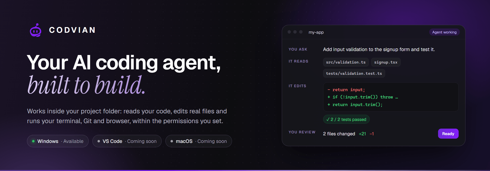
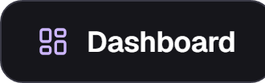
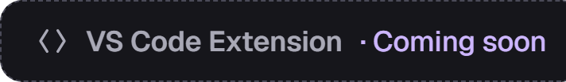
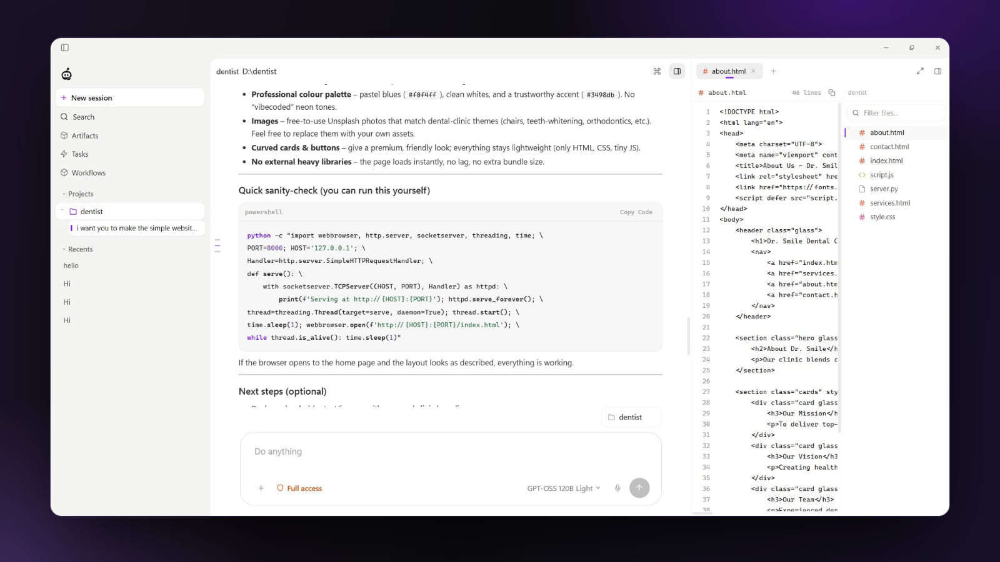
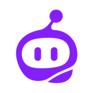

 

### The AI coding agent that works inside your real projects

CODVIAN reads your code, edits real files and runs your terminal, Git and browser, within the permissions you set.

 

&nbsp;
&nbsp;
&nbsp;

  

<a href="https://codvian.com/features/">Features</a> &nbsp;·&nbsp; <a href="https://codvian.com/docs/">Documentation</a> &nbsp;·&nbsp; <a href="https://codvian.com/pricing/">Pricing</a> &nbsp;·&nbsp; <a href="https://codvian.com/models/">Models</a> &nbsp;·&nbsp; <a href="https://codvian.com/blog/">Blog</a> &nbsp;·&nbsp; <a href="mailto:support@codvian.com">Support</a>

 

## About CODVIAN

CODVIAN is an AI-powered coding platform. Its core is **CODVIAN Desktop**, a Windows desktop AI coding agent that works
inside your project folder: it understands your project, plans multi-step changes, edits real files, runs commands and
checks its own work, while you decide what it is allowed to do.

Your account, credits and purchases live in the **CODVIAN dashboard** at [app.codvian.com](https://app.codvian.com).
A **VS Code extension** is being prepared for the Visual Studio Marketplace.

 

## Why CODVIAN

<table>
<tr>
<td width="50%" valign="top">

#### Works in your project
Point it at a folder. It reads the code, edits real files and keeps each chat tied to its project.

</td>
<td width="50%" valign="top">

#### Runs your tools
Terminal, Git and an integrated browser sit in the right panel, so the agent can test what it builds.

</td>
</tr>
<tr>
<td width="50%" valign="top">

#### You set the limits
Three access modes per session, with **Allow / Ask / Deny** for every kind of action.

</td>
<td width="50%" valign="top">

#### Your choice of model
Use CODVIAN's managed models with your account, or bring your own provider key or a local model. Switch per message.

</td>
</tr>
</table>

 

## Key capabilities

| Area | What you get |
| :-- | :-- |
| **Workspace** | Projects that keep chats, files and context together · sessions and recents with full history · command palette search across sessions, projects, settings and files · Files, Browser and Terminal side by side with the chat |
| **Agent tools** | Read, create and edit source files · run shell commands and scripts in your local environment · inspect Git changes and keep checkpoints you can recover from · open your app in an integrated browser, click through it and read the console |
| **Work tracking** | Artifacts: every file the agent created or edited, with the diff one click away · Task Center for agent runs, background agents and scheduled tasks, resumable when interrupted · Workflows you record once and replay · live token usage, rolling 24-hour totals and budget guardrails |
| **Personal and extensible** | Saved memories that carry useful facts across sessions · reusable skills for specific jobs · connections to providers, custom OpenAI-compatible endpoints and gateways · voice dictation and file or image attachments |
| **Account** | Sign in with Google · a free daily allowance · one-time credit packs and add-on credits, balance and credit history in the [dashboard](https://app.codvian.com) |

 

## Applications and availability

| Application | Status | Get it |
| :-- | :-- | :-- |
| **CODVIAN Desktop for Windows** Windows 10 / 11 · 64-bit |  | [Microsoft Store](https://apps.microsoft.com/detail/9N8LTG6867B4) · [Download page](https://codvian.com/download/) |
| **CODVIAN VS Code Extension** |  | Being prepared for the Visual Studio Marketplace |
| **CODVIAN Desktop for macOS** |  | [Request early access](mailto:hello@codvian.com?subject=macOS%20early%20access) |
| **CODVIAN Dashboard** (web) |  | [app.codvian.com](https://app.codvian.com) |

 

## Desktop App

 
CODVIAN Desktop on Windows: the project chat, an open file and the project's files in the right panel.

 

CODVIAN Desktop is a full coding workspace and is free to download. It installs from the official Microsoft Store
listing, and updates arrive automatically.

- **Project-first.** Attach a folder; the agent reads your code and edits files in place, and every chat stays tied to its project.
- **Visible work.** Created and edited files are collected per session as Artifacts, and long runs continue in the Task Center.
- **Local by default.** Chats, projects and memories are stored on your device and are not synced by CODVIAN. Provider
  keys you add are encrypted in the Windows keychain.

 

## VS Code Extension

The CODVIAN extension for Visual Studio Code is being prepared for publication on the Visual Studio Marketplace.
It is **coming soon**. This page and the [download page](https://codvian.com/download/) will link to the official
Marketplace listing once it is published. Please install it only from that official listing.

 

## AI coding experience

**Four steps, every one visible.**

| Step | What happens |
| :-- | :-- |
| **1 · You ask** | Describe the outcome, for example *"Add input validation to the signup form and test it."* |
| **2 · It reads** | The agent opens the files that matter in your project. |
| **3 · It edits and tests** | It changes real files and runs your tests or commands. |
| **4 · You review** | You see every changed file and its diff before you move on. |

**Reasoning on demand.** Five effort levels (Light, Medium, High, Extra High and Ultra) on one slider in the composer.
Use Light or Medium for quick fixes and the higher levels for multi-file work. You can change it for any message.

**Models: managed access and your own keys.** These are two separate options.

| | CODVIAN models | Your own key (BYOK) or a local model |
| :-- | :-- | :-- |
| **What it is** | Models CODVIAN provides through your CODVIAN account | A provider account or local model server you configure yourself in Desktop |
| **How it is paid** | A free daily allowance, or credits from one-time packs and add-on credits ([pricing](https://codvian.com/pricing/)) | Free on the CODVIAN side; the provider bills your own account under its terms |
| **Where requests go** | Through your CODVIAN account | To the provider or local server you chose |
| **Options** | The current list is on the [Models page](https://codvian.com/models/) | 70+ supported providers, custom OpenAI-compatible endpoints, and local models through Ollama or LM Studio |

 

## Getting started

1. **Install.** Open the [Microsoft Store listing](https://apps.microsoft.com/detail/9N8LTG6867B4) and install CODVIAN.
2. **Sign in.** Choose *Continue with Google* and finish in your browser.
3. **Add a project.** Pick a folder, choose a CODVIAN model or connect your own provider or local model, and send your first task.

The [documentation](https://codvian.com/docs/#getting-started) walks through setup, a first reviewable task and good habits for agent work.

 

## Downloads

| Platform | Official source |
| :-- | :-- |
| Windows 10 / 11 (64-bit) | [CODVIAN on the Microsoft Store](https://apps.microsoft.com/detail/9N8LTG6867B4) |
| macOS | Coming soon · [request early access](mailto:hello@codvian.com?subject=macOS%20early%20access) |
| VS Code | Coming soon on the Visual Studio Marketplace |

Always download CODVIAN from [codvian.com/download](https://codvian.com/download/) or the official store listings.
This repository does not host installers or extension packages.

 

## Documentation and resources

| Resource | Link |
| :-- | :-- |
| Getting started | [codvian.com/docs/#getting-started](https://codvian.com/docs/#getting-started) |
| Installation on Windows | [codvian.com/docs/#installation](https://codvian.com/docs/#installation) |
| Your first project | [codvian.com/docs/#first-project](https://codvian.com/docs/#first-project) |
| Models and providers | [codvian.com/docs/#models-providers](https://codvian.com/docs/#models-providers) |
| Bring your own key | [codvian.com/docs/#byok](https://codvian.com/docs/#byok) |
| Local models | [codvian.com/docs/#local-models](https://codvian.com/docs/#local-models) |
| Using the agent | [codvian.com/docs/#using-agent](https://codvian.com/docs/#using-agent) |
| Developer guide | [codvian.com/developers](https://codvian.com/developers/) |
| Features tour | [codvian.com/features](https://codvian.com/features/) |
| Security and data | [codvian.com/security](https://codvian.com/security/) |
| Blog | [codvian.com/blog](https://codvian.com/blog/) |

 

## Frequently asked questions

<b>What is CODVIAN?</b>

 
A Windows desktop AI coding agent that works inside your project folder. It reads your code, edits real files, and runs
your terminal, Git and browser, within the permissions you set.

<b>Is CODVIAN a subscription?</b>

 
No. CODVIAN credit packs are one-time purchases, with no automatic renewal. You buy credits only when you want them, in
the <a href="https://app.codvian.com">dashboard</a>. Current packs and prices are on the <a href="https://codvian.com/pricing/">pricing page</a>.

<b>Is there a free plan?</b>

 
Yes. A free daily allowance refreshes on a rolling 24-hour window and includes an available free model. Connecting your
own provider key or a local model in Desktop is always free on the CODVIAN side. Details are on the
<a href="https://codvian.com/pricing/">pricing page</a>.

<b>Can I use my own API key or a local model?</b>

 
Yes, in CODVIAN Desktop. You configure the provider connection yourself; requests made with your key go to that provider
and are billed by that provider. Keys are encrypted in the Windows keychain. Local models are supported through Ollama
and LM Studio. See <a href="https://codvian.com/docs/#byok">Bring your own key</a>.

<b>Where is my code and chat history stored?</b>

 
Chats, projects and memories are stored on your device and are not synced by CODVIAN. The content of a request is sent to
the model you choose for it. See <a href="https://codvian.com/security/">Security and data</a> and the
<a href="https://codvian.com/privacy/">Privacy policy</a>.

<b>When will the VS Code extension and the macOS app be available?</b>

 
Both are coming soon. The VS Code extension will be published on the Visual Studio Marketplace, and this page will link
to the official listing. For macOS you can <a href="mailto:hello@codvian.com?subject=macOS%20early%20access">request early access</a>.

<b>Is CODVIAN open source?</b>

 
No. This repository contains public product information only. CODVIAN's application source code is proprietary and is
not published here.

 

## Support and contact

| | |
| :-- | :-- |
| **Technical support and help** | [support@codvian.com](mailto:support@codvian.com) |
| **General enquiries** | [hello@codvian.com](mailto:hello@codvian.com) |
| **Contact page** | [codvian.com/contact](https://codvian.com/contact/) (support, bug reports, billing, security and business questions) |

 

## Official links

| | |
| :-- | :-- |
| Website | [codvian.com](https://codvian.com) |
| Dashboard | [app.codvian.com](https://app.codvian.com) |
| Download | [codvian.com/download](https://codvian.com/download/) |
| Microsoft Store | [CODVIAN for Windows](https://apps.microsoft.com/detail/9N8LTG6867B4) |
| Pricing | [codvian.com/pricing](https://codvian.com/pricing/) |
| Models | [codvian.com/models](https://codvian.com/models/) |
| About | [codvian.com/about](https://codvian.com/about/) |
| LinkedIn | [linkedin.com/company/codvian](https://www.linkedin.com/company/codvian) |
| Instagram | [@codvianofficial](https://www.instagram.com/codvianofficial/) |
| Legal | [Privacy](https://codvian.com/privacy/) · [Terms](https://codvian.com/terms/) · [Cookies](https://codvian.com/cookies/) · [Refunds](https://codvian.com/refund/) · [Acceptable use](https://codvian.com/acceptable-use/) |

 

## Repository scope and licensing notice

This is CODVIAN's official public product-information repository. It provides product information, official links and
public brand resources.

- It does **not** contain CODVIAN's application source code. Desktop, VS Code extension and service development happens
  in private infrastructure.
- It is **not** an open-source release, and nothing here grants a licence to CODVIAN software.
- The CODVIAN name, logo and images in this repository are CODVIAN brand assets. The product screenshot comes from
  CODVIAN's official Microsoft Store listing.

 

 
© 2026 CODVIAN. All rights reserved.

